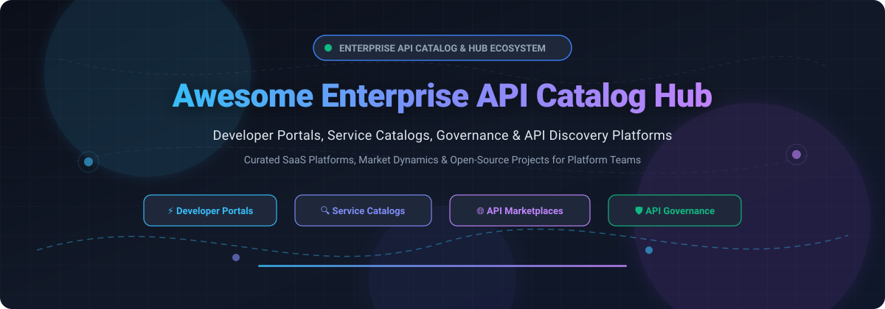

  

  
  
  
  
  
  

# 🚀 Awesome Enterprise API Catalog & Hub 🌐

> 🌟 **A curated index of top-tier Enterprise API Catalogs, Internal Developer Portals (IDPs), Service Catalogs, and API Governance & Discovery Ecosystems — comparing SaaS platforms, market valuations, pricing models, and production-ready open-source projects.**

---

## 📑 Table of Contents
- [📊 Sector Overview & Market Dynamics](#-sector-overview--market-dynamics)
- [🏢 SaaS & Hosted Enterprise Platforms](#-saas--hosted-enterprise-platforms)
- [🔓 Open-Source GitHub Projects](#-open-source-github-projects)
- [💡 Architectural Evaluation & Key Trade-offs](#-architectural-evaluation--key-trade-offs)
- [📈 Star History](#-star-history)
- [💖 Support & Community](#-support--community)
- [🤝 How to Contribute](#-how-to-contribute)
- [⚖️ Disclaimer](#-disclaimer)

---

## 📊 Sector Overview & Market Dynamics

The global **API Management and Developer Portal market** is estimated at **$8B–$11B**, projected to grow at a robust **16%–22% CAGR** to surpass **$30B+** over the next decade. 

The sector exhibits a **moderately concentrated, bifurcated structure**:
- 🏛️ **Concentrated Core (Enterprise Giants):** Major hyperscalers and legacy enterprise software giants (Google Cloud Apigee, Salesforce MuleSoft, Microsoft) command roughly **55%–62%** of core enterprise infrastructure spend.
- 🧩 **Fragmented Edge (API-First & Portals):** Specialized API-first platforms and internal developer portals (Postman, Kong, Port, Spotify Backstage) capture a rapidly growing, fragmented share catering to multi-cloud cataloging, developer experience (DevEx), microservice ownership tracking, and agentic workflows.

---

## 🏢 SaaS & Hosted Enterprise Platforms

Enterprise-ready hosted platforms providing turnkey API catalogs, developer experience portals, service catalogs, and API discovery engines. Sorted descending by company size (valuation / revenue).

| 🏷️ Product | 🏛️ Company Size (Valuation / Revenue) | 📝 Description | 💳 Pricing (Starting) | 🎁 Free Tier / Trial Limits |
|:---|:---|:---|:---|:---|
| **[Apigee API Hub](https://cloud.google.com/apigee)** | **~$2.1T Market Cap** (Alphabet / Google Cloud ~$35B+ ARR) | Enterprise API catalog & governance tool within Google Cloud's Apigee suite. | Pay-as-you-go Base Environment: **$0.50/hour/region** (~$365/month + $20/1M proxy calls; API Hub features included at no extra charge) | **60-day free trial** (Apigee Evaluation tier sandbox environment) |
| **[MuleSoft Anypoint Exchange](https://www.mulesoft.com/)** | **~$280B Market Cap** (Salesforce / MuleSoft ~$1.5B+ ARR) | Catalog of reusable APIs, connectors, and developer portals in Anypoint Platform. | Integration Starter: **$2,000/month** (billed annually at $24,000/year) | **30-day free trial** (full Anypoint Platform access; 30-day metric retention) |
| **[Postman API Catalog](https://www.postman.com/)** | **$5.6B Valuation** (~$310M ARR) | Centralized view of APIs across teams with governance and discovery features. | Enterprise: **$49/user/month** (annual) | **Free forever**: 1 user only (10,000 API calls/month, 5 integrations); **30-day Enterprise trial** |
| **[Kong Konnect](https://konghq.com/)** | **$2.0B Valuation** (~$100M+ ARR) | API lifecycle management and service catalog with multi-cloud control planes. | Plus tier: **$25/month** (Serverless Control Plane; includes 1M requests/month) | **30-day full Enterprise free trial** (unlimited trial evaluation, 30-day analytics retention) |
| **[Axway Amplify Engage](https://www.axway.com/)** | **~$1.3B Market Cap** (~$800M+ Revenue) | API catalog and enterprise marketplace for discovering and governing API assets. | Minimum entry package: **5 Assets / 10 Subscriptions** (Enterprise contract-based quote) | **30-day guided trial / evaluation PoC** (available upon request via sales) |
| **[Port](https://www.port.io/)** | **$800M Valuation** (Series C, ~$20M+ ARR) | Internal developer portal with software catalog, self-service actions, and scorecards. | Basic: **$30/user/month** (annual) | **Free forever**: 15 seats, 10,000 entities, 400 runs/month |
| **[Cortex](https://www.cortex.io/)** | **$470M Valuation** (Series C, ~$15M+ ARR) | Internal developer portal with service catalog, scorecards, and initiatives. | Baseline entry: **$39,000/year** (~$65/user/month for 50 users via AWS Marketplace) | **14-day to 30-day free trial** / custom PoC (available upon request via sales/marketplace) |
| **[OpsLevel](https://www.opslevel.com/)** | **~$75M Valuation** (Series A, ~$5M-$10M ARR) | Internal developer portal with service catalog, scorecards, and campaigns. | Baseline entry: **$39/user/month** (annual contract; ~$46,800/year for 100 users) | **14-day to 30-day free trial** / custom PoC (available upon request via sales) |

---

## 🔓 Open-Source GitHub Projects

Self-hosted and community-driven API catalogs, gateways with portal capabilities, and documentation hubs. Sorted descending by GitHub stargazers count.

| 📦 Project | ⭐ Stars_Badge | 📜 Description |
|:---|:---|:---|
| **[Kong Gateway](https://github.com/Kong/kong)** |  | **Cloud-Native API Gateway & Service Hub.** Apache-2.0. High-performance, Lua/Nginx-based API gateway connecting microservices, routing APIs, and offering native developer portal and service registry plugins. |
| **[Backstage](https://github.com/backstage/backstage)** |  | **The industry-standard open-source developer portal framework.** Apache-2.0, CNCF Incubating project created by Spotify. Centralized software catalog for microservices, APIs, libraries, TechDocs, and hundreds of community plugins. |
| **[Swagger UI](https://github.com/swagger-api/swagger-ui)** |  | **OpenAPI Interactive Documentation & Discovery.** Apache-2.0. The ubiquitous visualization tool that turns OpenAPI (Swagger) specifications into dynamic, interactive API discovery portals. |
| **[Redoc](https://github.com/redocly/redoc)** |  | **Responsive OpenAPI/Swagger Documentation Portal.** MIT. Clean 3-panel API documentation and discovery portal generator for responsive, production-ready enterprise catalogs. |
| **[Apache APISIX](https://github.com/apache/apisix)** |  | **Dynamic Cloud-Native API Gateway & Management.** Apache-2.0. Full-lifecycle API management platform featuring dynamic routing, service discovery, authentication, and a developer-friendly management dashboard. |
| **[Scalar](https://github.com/scalar/scalar)** |  | **Modern Open-Source API Reference & Developer Portal.** MIT. Beautiful, customizable developer portal and interactive API reference generator supporting OpenAPI/Swagger specifications. |
| **[Stoplight Elements](https://github.com/stoplightio/elements)** |  | **Embeddable API Documentation & Portal Components.** Apache-2.0. Web components for building custom API documentation and catalog portals from OpenAPI specs and Markdown docs. |
| **[WSO2 API Manager](https://github.com/wso2/product-apim)** |  | **Full Enterprise API Lifecycle Management & Developer Portal.** Apache-2.0. Comprehensive open-source platform offering an API publisher, developer marketplace, gateway, and governance tooling. |
| **[Apiman](https://github.com/apiman/apiman)** |  | **Open-Source API Management & Catalog.** Apache-2.0. Lightweight API management and cataloging engine with policy enforcement, metrics, and developer management UI. |
| **[Gravitee API Management](https://github.com/gravitee-io/gravitee-api-management)** |  | **Event-Native API Management & Developer Portal.** Apache-2.0. Complete API management solution featuring an API catalog, developer portal, API publisher, and real-time streaming analytics. |

---

## 💡 Architectural Evaluation & Key Trade-offs

- 🛠️ **Framework vs. Turnkey SaaS:** **Backstage** is a flexible framework requiring dedicated engineering investment to configure and maintain plugins, while turnkey SaaS offerings like **Port**, **Cortex**, or **OpsLevel** provide rapid time-to-value with managed scorecards and catalogs.
- 🌐 **Full Gateway Suites vs. Catalog Hubs:** Hyperscalers (**Google Cloud Apigee**, **Salesforce MuleSoft**) and API gateways (**Kong**, **APISIX**) unify traffic routing, security policies, and catalog discovery under a single pane of glass, whereas standalone developer portals aggregate metadata across heterogeneous multi-cloud architectures.
- 🔒 **Governance & Access Controls:** Enterprise API catalogs contain sensitive service topology and ownership metadata; enforce strict RBAC, automated syncs with CI/CD and Git, and audit logging.

---

## 📈 Star History

---

## 💖 Support & Community

Thank you so much for exploring and supporting **Awesome Enterprise API Catalog Hub**! ⭐

If you find this repository valuable:
- 🌟 **Star** this repository to help others discover it.
- 🍴 **Fork** it and submit contributions or suggest new catalog solutions.
- 📢 **Share** it with fellow platform engineers, architects, and DevOps practitioners.
- ☕ **Buy me a coffee / Sponsor**: If you'd like to support continued maintenance and curation of open developer resources, consider sponsoring via the [GitHub Sponsor Dashboard](https://github.com/sponsors/ishandutta2007).

---

## 🤝 How to Contribute

1. 🍴 Fork the repository.
2. 🌿 Create your feature branch (`git checkout -b feature/add-new-catalog`).
3. 📝 Add or update entries in `README.md` following the existing format.
4. 🔗 Include project name, official URL, concise description, and licensing/pricing details.
5. 🚀 Submit a Pull Request with a clear explanation of additions.

---

## ⚖️ Disclaimer

- 📌 This is an independent, community-curated list — not exhaustive and not an official corporate endorsement.
- 🔐 API catalogs and developer portals handle internal service metadata and ownership information; always configure access controls and avoid exposing sensitive internal endpoints or credentials.
- 📊 Market sizing and valuation figures are compiled from public regulatory filings, venture funding announcements, and industry research reports.

---

  <b>Built with ❤️ for platform engineers, developer experience teams, and enterprise architects.</b> 
  Let's make enterprise API catalogs more open, discoverable, and developer-friendly.

